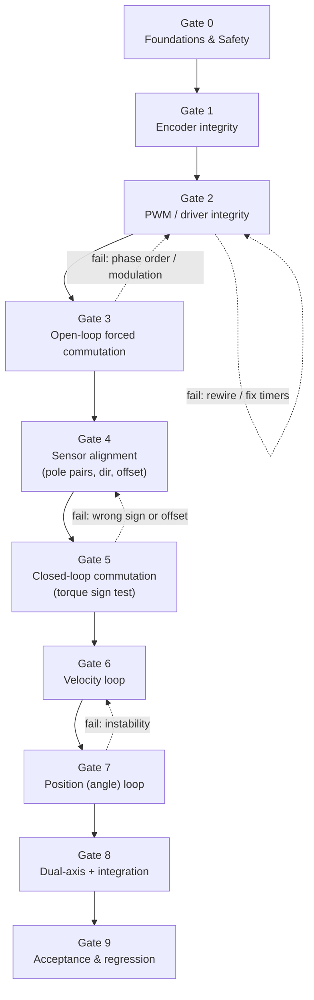

# FOC Bring-Up Plan (clean-slate, voltage-mode, dual-target)

A phase-gate procedure for rebuilding the field-oriented-control (FOC) firmware for
the dual-axis LiDAR gimbal from scratch. The goal is not to "make the motor move" - it
is to **guarantee** a working FOC program by passing a series of engineering gates,
where each gate is validated by **measured evidence** before the next one is attempted.

## 0. Purpose and ground rules

The previous FOC implementation is being abandoned in favour of a clean rebuild. The
risk with any FOC bring-up is that several independent things must all be correct at
once (phase wiring, modulation math, encoder direction, electrical offset, loop tuning),
and when the motor misbehaves it is impossible to tell *which* layer is wrong. This plan
removes that ambiguity by bringing each layer up **in isolation, in dependency order**,
and refusing to advance until the current layer is proven.

### End-state definition (scope)

- **Voltage-mode FOC.** Commutation is closed on the AS5048 magnetic encoder. Torque is
  commanded by computing a phase voltage `Vq` from a motor model
  (`estimate_Vq()` in [src/foc_controller/FOCController.cpp](../src/foc_controller/FOCController.cpp)),
  **not** from a measured-current PI loop. There is **no current feedback** in the final
  controller. (`src/current_sense/` is out of scope and stays excluded from both builds.)
- **Dual-target parity.** Every layer is exercised on **both** the STM32G4 Nucleo
  (`[env:stm32g4]`) and the Teensy 4.1 (`[env:teensy41]`) targets, through the shared
  `PWMDriver` / `Sensor` virtual interfaces. Hardware-specific code lives only behind
  those interfaces (e.g. [src/pwm_driver/stm32g4/](../src/pwm_driver/stm32g4/)).
- **Control topology.** Cascade: position (angle) loop -> velocity loop -> `estimate_Vq`
  -> inverse Park + Clarke -> midpoint-clamped SVPWM -> `PWMDriver::setPwm()`.

### The non-negotiable rules

1. **No gate is skipped.** Gates are ordered by dependency; a later gate's evidence is
   meaningless if an earlier gate has not passed.
2. **No gate passes on intuition.** "Looks like it's spinning" is not a pass. Each gate
   has explicit numeric / observable **exit criteria** captured as evidence (serial log,
   scope capture, or recorded measurement).
3. **A failed gate loops back, it does not get worked around.** If a symptom appears two
   gates later, the fault is almost always in the last gate that was waved through.
4. **Safety is always armed.** The standing abort criteria (Section 2) apply during
   every gate, not just the motor-spinning ones.

### Clean-slate strategy: what to keep vs rewrite

| Layer | Decision | Rationale |
|---|---|---|
| `PWMDriver` + adapters ([src/pwm_driver/](../src/pwm_driver/)) | **Keep, re-test** | Hardware timer logic is proven; re-validate at Gate 2, do not rewrite. |
| `Sensor` / `AS5048` ([src/sensor/](../src/sensor/)) | **Keep, re-test** | Encoder driver is proven; re-validate at Gate 1. |
| `PIDControl` ([src/pid_control/](../src/pid_control/)) | **Keep** | Generic; re-tuned at Gates 6-7. |
| Electrical-offset autocal ([src/tests/sensor/electrical_offset_autocal_test.hpp](../src/tests/sensor/electrical_offset_autocal_test.hpp)) | **Keep** | Stiction-bracket method is documented and trusted ([docs/motor_calibration_findings.md](motor_calibration_findings.md)). |
| `FOCController` ([src/foc_controller/](../src/foc_controller/)) | **Rewrite from scratch** | This is the suspect layer; re-derive it gate-by-gate. |
| `src/current_sense/` | **Shelve / delete** | Not used in voltage mode; already excluded from both builds in [platformio.ini](../platformio.ini). |

## 1. The phase-gate model

Each gate is exercised by a dedicated bench test, switched in via the entry-point stub
rather than the full `main`:

- **STM32G4:** edit [src/_stm32g4_main_stub.cpp](../src/_stm32g4_main_stub.cpp) to call the
  gate's test function, then `pio run -e stm32g4 --target upload -t monitor`.
- **Teensy 4.1:** call the equivalent test from the Teensy entry point, then
  `pio run -e teensy41 --target upload -t monitor`.

Most gate harnesses already exist under [src/tests/](../src/tests/); the rebuild is
mostly about re-walking them in order against a freshly written `FOCController`.

## 2. Standing safety and abort criteria

These apply at **every** gate from the moment coils can be energised. Wire them in before
Gate 3 and leave them armed for the rest of the bring-up.

| Hazard | Trip condition | Action |
|---|---|---|
| Overcurrent | Bench supply hits its current limit, or any phase exceeds `MOTOR_CURRENT_LIMIT` (0.8 A) headroom | Supply folds back; `disable()` the driver (`EN` low) |
| Thermal | Motor or DRV8313 too hot to touch / smell | Kill power, investigate before continuing |
| Runaway | Rotor accelerates uncommanded, or velocity diverges | E-stop / `disable()`; treat as a Gate 3-5 failure |
| Encoder fault | AS5048 error/parity flag set, or angle frozen/garbage | Abort the loop; do not command torque off a bad angle |
| Software watchdog | `loop()` stalls / sensor `update()` returns false | Controller refuses to drive (existing guard in `FOCController::loop()`) |

Bench setup prerequisites (Gate 0 verifies these):

- **Current-limited supply** set just above the gate's expected draw (e.g. 1.0-1.5 A for
  alignment), so a wiring fault folds back instead of cooking the driver.
- **`MOTOR_VOLTAGE_LIMIT` = 12.0 V**, **`VOLTAGE_POWER_SUPPLY` = 12.0 V**, current
  ceiling **`MOTOR_CURRENT_LIMIT` = 0.8 A** (from [src/utils/constants.h](../src/utils/constants.h)).
- **Mechanically free rotors** for Gates 3-5 (unloaded, free to spin ~1 turn) - the
  stiction-bracket calibration depends on this.
- Easy physical access to the **`EN` line / power switch** for a manual e-stop.

## 3. Evidence-table template

Every gate is signed off with a row like the following (keep these in a bring-up log).
"Pass" must be an observation, never an opinion.

| Field | Example entry |
|---|---|
| Gate | 3 - Open-loop forced commutation |
| Target(s) | STM32G4 + Teensy 4.1 |
| Test harness | `src/tests/motor/stm32g4_open_loop.hpp` |
| Procedure run | Rotating Vq = 2.0 V at 0.5 rev/s, both directions |
| Instrumentation | Serial log of commanded elec angle; scope on 2 phases; encoder angle stream |
| Measured result | Smooth rotation both ways; phase currents balanced; no cog jumps |
| Exit criteria met? | YES |
| Evidence link | `logs/gate3_stm32g4.txt`, `scope_gate3.png` |
| Notes / anomalies | Phase B/C initially swapped -> looped back, re-mapped pins |

## 4. The engineering gates

For each gate: **Entry criteria** (what must already be true), **Procedure** (what to
do), **Instrumentation** (how you observe it), **Exit criteria** (the measured pass bar),
and **Abort / rollback** (what failure means and where to loop back).

---

### Gate 0 - Foundations & Safety

Prove the toolchain, both build targets, basic I/O, and the safety envelope before any
coil is energised.

- **Entry criteria:** Bench supply, DRV8313 + GM2804 + AS5048 wired per
  [src/utils/constants.h](../src/utils/constants.h) pin map; ST-Link and Teensy
  programmers available.
- **Procedure:**
  1. Build and flash both environments: `pio run -e stm32g4` and `pio run -e teensy41`.
  2. Run a heartbeat / serial-alive test
     ([src/tests/system/stm32g4_heartbeat_test.hpp](../src/tests/system/stm32g4_heartbeat_test.hpp))
     on STM32G4 and the equivalent on Teensy at `BAUD_RATE` (460800).
  3. With the driver `EN` line held low, confirm the motor phases are **de-energised**
     (no holding torque, free to spin by hand).
  4. Set the bench supply current limit to a safe ceiling.
- **Instrumentation:** Serial monitor (heartbeat counter), multimeter on phase outputs,
  bench supply current readout.
- **Exit criteria:**
  - Both targets compile, flash, and print a heartbeat over serial.
  - `EN` low provably leaves coils unpowered (rotor spins freely, ~0 phase voltage).
  - Supply current limit set with headroom below `MOTOR_CURRENT_LIMIT`.
- **Abort / rollback:** A target that won't build/flash blocks everything - fix
  toolchain/board config first. If `EN` low does **not** de-energise coils, stop: the
  driver enable path is miswired and Gate 2+ would be unsafe.

---

### Gate 1 - Encoder integrity

The entire controller is built on the encoder angle. If the angle is wrong, every later
gate is built on sand.

- **Entry criteria:** Gate 0 passed. AS5048 on the SPI bus
  ([src/sensor/AS5048.hpp](../src/sensor/AS5048.hpp), `SPI_MODE1`, 10 MHz).
- **Procedure:**
  1. Run the sensor test ([src/tests/sensor/sensor_test.hpp](../src/tests/sensor/sensor_test.hpp)
     and [src/tests/sensor/stm32g4_sensor_test.hpp](../src/tests/sensor/stm32g4_sensor_test.hpp)).
  2. Rotate the rotor by hand through a full turn; confirm the reported angle sweeps
     `0 -> 2pi` monotonically and wraps cleanly (no jumps mid-rotation).
  3. Read diagnostics (AGC, magnitude, OCF/COF, parity) and confirm they sit in a healthy
     band; magnet not too close/far.
  4. Sanity-check velocity estimation
     ([src/tests/sensor/velocity_spike_test.hpp](../src/tests/sensor/velocity_spike_test.hpp),
     [src/tests/sensor/noise_test.hpp](../src/tests/sensor/noise_test.hpp)).
- **Instrumentation:** Serial stream of raw angle + diagnostics; optionally the Python
  plotters under `UI/`.
- **Exit criteria:**
  - Angle tracks a hand rotation cleanly over `0..2pi` with correct wrap.
  - Error/parity flag rate ~0; AGC and magnitude within spec.
  - Velocity estimate is smooth and sign-correct for a known hand motion, with no
    spurious spikes at the wrap boundary.
- **Abort / rollback:** Garbage/frozen angle -> SPI wiring, CS pin, mode, or clock issue.
  Frequent parity errors -> bus integrity / magnet placement. Do not proceed to torque
  with a flaky encoder.

---

### Gate 2 - PWM / driver integrity

Prove that the three phase voltages requested in software become correct, safe waveforms
at the DRV8313 inputs - **without** relying on the motor producing useful torque.

- **Entry criteria:** Gates 0-1 passed.
- **Procedure:**
  1. Run the driver test ([src/tests/driver/stm32g4_driver_test.hpp](../src/tests/driver/stm32g4_driver_test.hpp))
     and verify each of the three duty channels is independently controllable.
  2. Verify **center-aligned** PWM at `MOTOR_PWM_FREQUENCY` (25 kHz)
     ([src/tests/driver/stm32g4_center_aligned_test.hpp](../src/tests/driver/stm32g4_center_aligned_test.hpp)).
  3. Verify `enable()` / `disable()` gate the outputs, and run the safe-stop test
     ([src/tests/driver/stm32g4_safe_stop_test.hpp](../src/tests/driver/stm32g4_safe_stop_test.hpp)).
  4. **Dual-motor timer audit:** confirm both axes' six PWM pins resolve to **six
     distinct timer instances** (per the architecture report
     [docs/STM32G4_architecture_report.md](STM32G4_architecture_report.md), Section 4);
     run the dual center-aligned test
     ([src/tests/driver/stm32g4_center_aligned_dual_test.hpp](../src/tests/driver/stm32g4_center_aligned_dual_test.hpp)).
- **Instrumentation:** Oscilloscope on phase outputs (frequency, alignment, line-to-line
  shape); the same on Teensy to confirm parity.
- **Exit criteria:**
  - Scope confirms 25 kHz, center-aligned, three independently controllable duties.
  - Midpoint-clamp modulation (`setPhaseVoltage()` math) yields the expected
    line-to-line waveform.
  - `disable()` / `EN` low cuts all outputs immediately.
  - Both motors' PWM run independently with no shared-timer interference.
- **Abort / rollback:** Wrong frequency or edge-aligned output -> timer config. Channels
  not independent or motors interfering -> timer allocation (loop within Gate 2). This is
  the last gate before torque - do not advance with any waveform anomaly.

---

### Gate 3 - Open-loop forced commutation

Drive a rotating field using a **synthesized** electrical angle (the encoder is ignored
here). This isolates and validates the **modulation math** (inverse Park + Clarke,
`setPhaseVoltage()`) and the **phase wiring order** - the two things most likely to be
wrong in a fresh build.

- **Entry criteria:** Gates 0-2 passed. Rotor mechanically free and unloaded.
- **Procedure:**
  1. Run the open-loop test ([src/tests/motor/stm32g4_open_loop.hpp](../src/tests/motor/stm32g4_open_loop.hpp)):
     set `Vd = 0`, a modest fixed `Vq` (e.g. 1.5-2.5 V), and ramp `electrical_angle`
     linearly at a slow open-loop rate.
  2. Observe the rotor: it should rotate smoothly and track the commanded direction.
  3. Reverse the commanded angle rate; confirm the rotor reverses.
  4. Optionally probe cogging/symmetry
     ([src/tests/driver/stm32g4_coil_cogging_test.hpp](../src/tests/driver/stm32g4_coil_cogging_test.hpp)).
- **Instrumentation:** Serial log of commanded electrical angle and phase voltages;
  visual rotor observation; scope on two phases (expect ~120deg-shifted sinusoids).
- **Exit criteria:**
  - Smooth rotation (no stutter / 60deg ratcheting that indicates a swapped phase).
  - Direction reverses correctly when the commanded angle rate reverses.
  - Current stays bounded under the limit at the chosen `Vq`.
- **Abort / rollback:** Cogging/jerky motion or rotation only one way -> two phases
  swapped: fix phase wiring or pin mapping and re-test (loop within Gate 3). If a single
  `Vq`/angle produces no torque at all, loop back to Gate 2.

> Note: per [docs/motor_calibration_findings.md](motor_calibration_findings.md), these
> motors are stiction-dominated when unloaded and will **not** lock synchronously to a
> continuously rotating field - they ratchet. Gate 3's pass criterion is "smooth,
> reversible motion proving phase order + modulation", **not** perfect synchronous lock.
> Precise alignment is the job of Gate 4.

---

### Gate 4 - Sensor alignment (pole pairs, direction, electrical offset)

Tie the encoder angle to the electrical angle. This produces the constants that
`calculate_electrical_angle()` depends on:
`normalise_angle(mechanical_angle * pole_pairs * sensor_direction - electrical_offset)`.

- **Entry criteria:** Gates 0-3 passed. Rotor free and unloaded.
- **Procedure:**
  1. Confirm `pole_pairs = 7` for the GM2804
     ([src/motor/GM2804.hpp](../src/motor/GM2804.hpp)).
  2. Resolve the `sensor_direction` sign by correlating commanded electrical angle (from
     Gate 3) against measured encoder angle; confirm `SENSOR_DIRECTION = 1` (CCW) holds.
  3. Run the stiction-bracket autocal
     ([src/tests/sensor/electrical_offset_autocal_test.hpp](../src/tests/sensor/electrical_offset_autocal_test.hpp))
     to measure `SENSOR_OFFSET_X` / `SENSOR_OFFSET_Y`.
  4. Write the offsets into [src/utils/constants.h](../src/utils/constants.h) and re-run;
     confirm `change vs stored offset` collapses to ~0.
- **Instrumentation:** The autocal's parseable `TGT` lines and per-motor summary
  (`electrical offset`, `circ_std`, `change vs stored offset`).
- **Exit criteria:**
  - `calculate_electrical_angle()` tracks the true field within the inherent ~0.5 rad
    2nd-harmonic saliency band.
  - `change vs stored offset` ~= 0 on a verification re-run for both motors.
  - Stored offsets match the documented values (X = 4.0852, Y = 2.5624) or are
    re-measured if the mount changed.
- **Abort / rollback:** High `circ_std` / inconsistent offset -> bracket offset below the
  stiction dead-band (increase it), or a Gate 1 encoder problem. A sign error here
  surfaces as a Gate 5 failure - so get the direction right before proceeding.

---

### Gate 5 - Closed-loop commutation (torque sign test)

First use of the **real encoder angle** to commutate. Prove that a positive `Vq`
produces torque in a consistent, correct direction - i.e. commutation is genuinely closed
on the sensor with the right sign and offset.

- **Entry criteria:** Gates 0-4 passed (offsets stored and verified).
- **Procedure:**
  1. In the rewritten `FOCController`, set `electrical_angle = calculate_electrical_angle()`
     from the live sensor, `Vd = 0`, and apply a small fixed `Vq > 0` directly (bypass the
     PID loops for this gate).
  2. Confirm the rotor develops torque in one consistent direction; gently perturb it and
     confirm it pushes back / holds.
  3. Flip the sign of `Vq`; confirm the torque direction flips.
- **Instrumentation:** Serial stream of `mechanical_angle`, `electrical_angle`, `Vq`, and
  bench-supply current.
- **Exit criteria:**
  - `+Vq` -> consistent torque in the expected direction; `-Vq` -> opposite. No runaway.
  - Holding torque is stable (rotor returns toward / resists displacement, not driven
    away).
  - Current stays under `MOTOR_CURRENT_LIMIT`.
- **Abort / rollback:** Torque in the wrong direction or runaway -> wrong
  `sensor_direction` sign or offset: loop back to **Gate 4**. Weak/erratic torque ->
  re-check Gates 2-3.

---

### Gate 6 - Velocity loop

Close the inner control loop: velocity error -> PI -> `estimate_Vq` -> `Vq`.

- **Entry criteria:** Gates 0-5 passed. Controller commutates correctly under fixed `Vq`.
- **Procedure:**
  1. Enable the velocity PI controller (`PID_velocity_controller`) feeding
     `target_q_current` -> `estimate_Vq()` -> `Vq` (the existing topology in
     [src/foc_controller/FOCController.cpp](../src/foc_controller/FOCController.cpp)).
  2. Start with `VELOCITY_P`/`VELOCITY_I`/`VELOCITY_D` from
     [src/utils/tweakable_params.h](../src/utils/tweakable_params.h); tune from a low gain
     upward.
  3. Command velocity steps and ramps; observe tracking, overshoot, settle, steady-state
     error. Use the PID test rig as a reference
     ([src/tests/motor/pid_test.hpp](../src/tests/motor/pid_test.hpp)).
- **Instrumentation:** Serial stream of `target_velocity`, `angular_velocity`,
  `velocity_error`, `Vq`; plot step responses.
- **Exit criteria:**
  - Tracks velocity setpoints within an agreed tolerance, both directions.
  - Settles without sustained oscillation or limit-cycle; no current-limit chatter.
  - `Vq` and current remain within limits across the operating range.
- **Abort / rollback:** Oscillation that won't tune out -> re-check velocity estimation
  (Gate 1 filtering / `VELOCITY_LOW_PASS_FILTER_TAU`) and commutation sign (Gate 5).

---

### Gate 7 - Position (angle) loop

Close the outer loop: angle error -> PI -> velocity setpoint -> (Gate 6 loop).

- **Entry criteria:** Gate 6 passed (stable velocity loop).
- **Procedure:**
  1. Enable the angle PI controller (`PID_angle_controller`) in `ControlMode::ANGLE`,
     using `findAngularError()` ([src/utils/quick_defs.h](../src/utils/quick_defs.h)) for
     shortest-path wrap.
  2. Tune `ANGLE_P`/`ANGLE_I`/`ANGLE_D` from
     [src/utils/tweakable_params.h](../src/utils/tweakable_params.h), respecting the
     velocity limits (`VELOCITY_UPPER_LIMIT` / `VELOCITY_LOWER_LIMIT`).
  3. Command angle steps in both directions, including across the `0`/`2pi` wrap; apply a
     disturbance and confirm hold.
- **Instrumentation:** Serial stream of `target_angle`, `mechanical_angle`,
  `angular_error`, plus the inner-loop signals.
- **Exit criteria:**
  - Settles to the target angle within tolerance, both directions, with no sustained
    oscillation.
  - Holds position under a modest disturbance.
  - Wrap is handled correctly (takes the shortest path; no full-turn unwinds).
- **Abort / rollback:** Instability or wind-up -> loop back to Gate 6 (inner loop must be
  solid first); check angle wrap handling and integrator limits.

---

### Gate 8 - Dual-axis + system integration

Bring up both axes together and integrate with the application layer, on **both** build
targets.

- **Entry criteria:** Gates 0-7 passed for at least one axis.
- **Procedure:**
  1. Repeat Gates 4-7 for the second motor (Y) - offsets are per-motor.
  2. Wire in the full system: `StateMachine`, `Interface` command listener, and the
     `SinusoidalScanPath` (as composed in
     [src/tests/foc/stm32g4_foc_test.hpp](../src/tests/foc/stm32g4_foc_test.hpp)).
  3. Run the scan path on both motors; exercise enable/disable, mode switches, and the
     e-stop path.
  4. Build, flash, and re-validate the integrated system on **both** `stm32g4` and
     `teensy41`.
- **Instrumentation:** `Interface::printFOCStatus()` serial telemetry; scan-path plot via
  `UI/` tools.
- **Exit criteria:**
  - Both motors track the scan path simultaneously without interference.
  - State machine + interface commands behave correctly; e-stop reliably disables drive.
  - Integrated firmware runs on both targets with identical control behaviour.
- **Abort / rollback:** Cross-axis interference -> revisit Gate 2 timer allocation. A
  fault appearing only when integrated -> isolate by disabling subsystems back to a known
  good gate.

---

### Gate 9 - Acceptance & regression

Define "done" quantitatively and lock in the means to detect regressions.

- **Entry criteria:** Gates 0-8 passed.
- **Procedure:**
  1. Agree an acceptance spec: e.g. angle settle time, steady-state error band, velocity
     tracking tolerance, peak current ceiling, and a soak-test duration.
  2. Run a sustained soak test on both motors / both targets at representative scan-path
     load.
  3. Record the gate harness list (Gates 0-8) as a **regression checklist** to re-run
     after any change to the control path, encoder mount, or wiring.
- **Instrumentation:** Telemetry capture over the soak; logged acceptance measurements.
- **Exit criteria:**
  - Meets the agreed acceptance spec on both targets.
  - No faults / drift over the soak period.
  - Regression checklist documented and reproducible.
- **Abort / rollback:** Any acceptance miss -> identify the responsible gate and loop
  back; do not relax the spec to force a pass.

## 5. Dual-target notes (STM32G4 + Teensy 4.1)

- **Shared abstraction is the contract.** All control logic (`FOCController`, PIDs,
  modulation in `setPhaseVoltage()`) is target-agnostic and sits above the `PWMDriver` and
  `Sensor` virtual interfaces. Only the adapters differ:
  `PWMDriverSTM32G4` vs `PWMDriverTeensy41`, both implementing the same
  `configure3PWM` / `write3PWM` / `stopPwmHardware` / `cleanupParams` hooks.
- **Per-target gate entry points.**
  - STM32G4: switch the active test in
    [src/_stm32g4_main_stub.cpp](../src/_stm32g4_main_stub.cpp), build with
    `pio run -e stm32g4 --target upload -t monitor`.
  - Teensy 4.1: call the equivalent harness from the Teensy entry point, build with
    `pio run -e teensy41 --target upload -t monitor`.
- **Gates that are target-sensitive:** Gate 2 (timer architecture differs most - the
  STM32G4 multi-timer 3PWM + `stm32_alignTimers` model has no Teensy analogue) and Gate 8
  (full integration). Gates 1, 3-7 should behave identically given a correct adapter; any
  divergence points at the adapter, not the control law.
- **Build filters:** keep `src/current_sense/` and unrelated `tests/` excluded per the
  `build_src_filter` settings already in [platformio.ini](../platformio.ini).

## 6. Summary

Working FOC is **guaranteed** not by clever code but by passing, in order, a chain of
gates each of which isolates exactly one source of failure:

1. Toolchain + safety, 2. Encoder, 3. PWM/driver waveforms, 4. Modulation math + phase
order (open loop), 5. Encoder-to-electrical alignment, 6. Closed-loop commutation sign,
7. Velocity loop, 8. Position loop, 9. Dual-axis integration, 10. Acceptance + regression.

When the motor misbehaves, the failure is - by construction - in the most recent gate
that was passed without solid evidence. Honour the rules in Section 0, keep the evidence
log in Section 3, and the rebuilt voltage-mode FOC controller will reach a known-good,
reproducible end-state on both targets.
