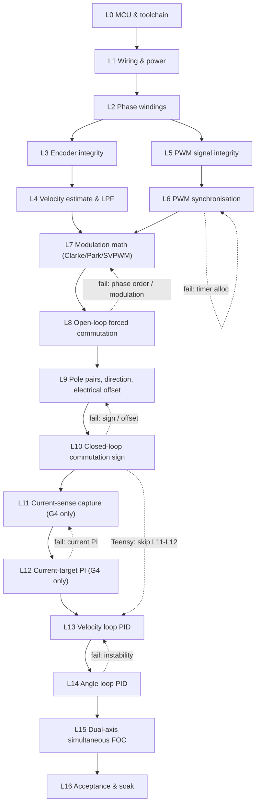

# FOC Bring-Up Test Plan (ground-up, layer-by-layer, dual-axis)

A phase-gate procedure for proving the dual-axis LiDAR-gimbal FOC firmware **from the
silicon up**. The previous test suite (AI-authored, opaque, untrustworthy) has been
deleted in full. This plan replaces it with a set of **small, human-readable, single-
purpose** test scripts, each of which validates exactly one layer of the system against
**numeric, observable exit criteria**.

The governing idea: FOC only works when many independent things are simultaneously
correct (wiring, phase order, timer sync, modulation math, encoder direction, electrical
offset, filter tuning, loop gains). When it misbehaves you cannot tell *which* layer is
wrong. This plan removes that ambiguity by bringing each layer up **in isolation, in
strict dependency order**, and refusing to advance until the current layer is proven with
evidence.

---

## 0. Ground rules (non-negotiable)

1. **No layer is skipped.** Layers are ordered by dependency. A later layer's evidence is
   meaningless if an earlier one has not passed.
2. **No layer passes on intuition.** "It looks like it's spinning" is not a pass. Every
   gate has an explicit numeric or scope-observable pass bar. Record it.
3. **A failed gate loops back, it does not get worked around.** If a symptom appears two
   layers later, the fault is almost always the last gate that was waved through.
4. **Every test script is small and readable.** One file, one purpose, one function,
   parseable serial output. If you cannot read a test in one sitting and say exactly what
   it proves, rewrite it. (This is the failure mode that produced the deleted suite.)
5. **Safety is always armed** from the moment coils can be energised (Section 3).

### End-state definition (scope)

- **Dual-target control topology.**
  - **STM32G4 (production):** measured-current FOC. Cascade: angle loop (1 kHz) → velocity
    loop (5 kHz) → **current PI** (20 kHz, measured Iq/Id via `InlineCurrentSenseSTM32G4`)
    → inverse Park → Clarke → midpoint-clamp SVPWM → `PWMDriver::setPwm()`.
  - **Teensy 4.1 (parity):** voltage-mode FOC. Same cascade rates, but the inner loop uses
    `estimate_Vq()` (motor R/Kv model) — **no current feedback**. `src/current_sense/`
    is not used on Teensy builds.
- **Loop rates** (editable in `src/utils/tweakable_params.h`): current 20 kHz, velocity
  5 kHz, angle 1 kHz. `FOCController::loop()` rate-gates each stage off `micros()`.
- **Dual-target.** Primary bench target is the **STM32G4 Nucleo** (`[env:stm32g4]`).
  Every axis-agnostic layer is also re-validated on **Teensy 4.1** (`[env:teensy41]`)
  through the shared `PWMDriver` / `Sensor` interfaces. **Teensy skips L11–L12** (no
  inline current sense) and advances L10 → L13.
- **Dual-axis.** Motors **X** and **Y** are brought up with **separate, duplicated** test
  scripts (`*_x_test.hpp` / `*_y_test.hpp`) run one at a time. The **final** gate runs
  full cascade FOC on **both axes simultaneously**.

---

## 1. System under test (grounding facts)

These are the concrete facts every test is written against. Pulled from
[src/utils/constants.h](../src/utils/constants.h),
[src/motor/GM2804.hpp](../src/motor/GM2804.hpp), and
[src/sensor/AS5048.hpp](../src/sensor/AS5048.hpp).

| Item | Motor X | Motor Y | Source |
|---|---|---|---|
| MCU (bench) | STM32G4 Nucleo (`nucleo_g474re`) | same board | `platformio.ini` |
| MCU (parity) | Teensy 4.1 | same board | `platformio.ini` |
| Driver | DRV8313, 3-PWM (high-side drive, no dead-time in FW) | same | arch report |
| Motor | GM2804, 7 pole pairs, `R=9.0 Ω`, `Kv=169`, `Ke=0.057` | same | `GM2804.hpp` |
| Phase pins (G4) | `N1=PA8 N2=PA9 N3=PA10` (TIM1) | `N1=PC6 N2=PC7 N3=PB9` (TIM8) | `constants.h` |
| Enable (G4) | `EN=PA7` | `EN=PB10` | `constants.h` |
| Encoder | AS5048A, 14-bit (CPR 16384), SPI mode 1, 10 MHz | same | `AS5048.hpp` |
| Encoder CS (G4) | `PB2` | `PB1` | `constants.h` |
| SPI bus (G4) | MISO `PB14`, MOSI `PB15`, SCK `PB13` (shared) | shared | `constants.h` |
| Sensor direction | `+1` (CCW) | `+1` (CCW) | `constants.h` |
| Electrical offset | `SENSOR_OFFSET_X` (to be re-measured) | `SENSOR_OFFSET_Y` (to be re-measured) | `constants.h` |
| PWM | 25 kHz, center-aligned | same | `constants.h` |
| Limits | `MOTOR_VOLTAGE_LIMIT=12 V`, `MOTOR_CURRENT_LIMIT=0.8 A`, `VPS=12 V` | same | `constants.h` |

> The current `SENSOR_OFFSET_X/Y` in `constants.h` (0.63 / 6.17) are **suspect** — they do
> not match the documented autocal values (X≈4.0852, Y≈2.5624) in
> [docs/motor_calibration_findings.md](motor_calibration_findings.md). They are
> **re-measured and rewritten at Layer 9**, not trusted before then.

---

## 2. Test harness conventions

Because the old suite was unreadable, structure is mandated here.

### 2.1 File layout & naming

Recreate `src/tests/` with one subfolder per layer. Every harness is a single
`inline void <name>()` in a `.hpp`, self-contained, called from the entry-point stub.

```
src/tests/
  mcu/        mcu_alive_test.hpp, loop_timing_test.hpp
  wiring/     gpio_map_x_test.hpp,     gpio_map_y_test.hpp
  windings/   phase_energize_x_test.hpp, phase_energize_y_test.hpp
  sensor/     encoder_integrity_x_test.hpp, encoder_integrity_y_test.hpp
              velocity_estimate_x_test.hpp, velocity_estimate_y_test.hpp
              pole_pair_dir_x_test.hpp,   pole_pair_dir_y_test.hpp
              electrical_offset_autocal_x_test.hpp, electrical_offset_autocal_y_test.hpp
  filter/     filter_char_x_test.hpp,    filter_char_y_test.hpp
  pwm/        pwm_channel_x_test.hpp,    pwm_channel_y_test.hpp
              pwm_center_aligned_x_test.hpp, pwm_center_aligned_y_test.hpp
              pwm_sync_x_test.hpp,       pwm_sync_y_test.hpp
              pwm_sync_dual_test.hpp
  modulation/ modulation_x_test.hpp,     modulation_y_test.hpp
  motor/      open_loop_x_test.hpp,      open_loop_y_test.hpp
  current_sense/ current_sense_x_test.hpp, current_sense_y_test.hpp
  foc/        torque_sign_x_test.hpp,    torque_sign_y_test.hpp
              current_loop_pi_x_test.hpp, current_loop_pi_y_test.hpp
              velocity_loop_x_test.hpp,  velocity_loop_y_test.hpp
              angle_loop_x_test.hpp,     angle_loop_y_test.hpp
              dual_foc_test.hpp
  system/     soak_test.hpp
```

**Rule: X and Y scripts are byte-for-byte identical except for the axis constants**
(`N*_X/EN_X/SENSOR_SPI_CS_X/SENSOR_OFFSET_X` vs the `_Y` set, and motor number `1` vs `2`).
Duplicate deliberately — do **not** parameterise into one file. Running the wrong axis
must be impossible by accident, and a per-axis file is the audit trail.

### 2.2 Running a test

- **STM32G4:** uncomment exactly **one** test include + call in
  [src/_stm32g4_main_stub.cpp](../src/_stm32g4_main_stub.cpp), then:
  ```
  pio run -e stm32g4 --target upload -t monitor
  ```
- **Teensy 4.1:** same, in [src/_teensy_main_stub.cpp](../src/_teensy_main_stub.cpp), then:
  ```
  pio run -e teensy41 --target upload -t monitor
  ```

> First action before any test builds: the stubs currently `#include` the deleted
> harnesses and will not compile. Reduce each stub to a single active include for the
> layer under test.

### 2.3 Serial output contract

Every harness prints machine-parseable lines so results can be logged/plotted, not eyeballed:

- A one-line banner: `TEST <name> axis=<X|Y> target=<g4|teensy>`.
- Streaming data as CSV rows with a fixed tag prefix, e.g. `DBG <a>,<b>,<c>` or
  `TGT <...>`, at a stated rate.
- A terminal verdict line the operator fills against the exit criteria:
  `RESULT <name> PASS|FAIL <key metric>=<value>`.

Reuse the existing telemetry where it helps (`Interface::sendDualMotorStatus()` /
`printFOCStatus()` and the `UI/` plotters) but the atomic gates should stand alone.

---

## 3. Standing safety & abort criteria

Apply at **every** gate from Layer 5 onward (first coil energisation). Wire them in and
leave them armed.

| Hazard | Trip condition | Action |
|---|---|---|
| Overcurrent | Bench supply hits its current limit, or a phase exceeds `MOTOR_CURRENT_LIMIT` (0.8 A) headroom | Supply folds back; `disable()` (`EN` low) |
| Thermal | Motor or DRV8313 too hot to touch | Kill power; investigate |
| Runaway | Rotor accelerates uncommanded / velocity diverges | E-stop / `disable()`; treat as Layer 8–10 failure |
| Encoder fault | AS5048 parity/error flag set, or angle frozen/garbage | Abort loop; never command torque off a bad angle |
| Software stall | `loop()` stalls / `sensor.update()` returns false | Controller refuses to drive (guard in `FOCController::loop()`) |

Bench prerequisites (verified at Layer 0/1):

- **Current-limited supply**, set just above each gate's expected draw (≈1.0–1.5 A during
  alignment) so a wiring fault folds back instead of cooking the DRV8313.
- **Mechanically free rotors** for Layers 8–10 (unloaded, free ≥1 turn) — the
  stiction-bracket calibration depends on this.
- Easy physical access to the `EN` line / power switch for a manual e-stop.

---

## 4. Evidence log

Every gate is signed off with a row (keep a `logs/bringup_log.md`). "Pass" is an
observation, never an opinion.

| Field | Example |
|---|---|
| Gate | L6.2 — Dual-motor timer independence |
| Axis / target | dual / stm32g4 |
| Script | `pwm/pwm_sync_dual_test.hpp` |
| Procedure | Both motors PWM at 25 kHz; scope one phase each |
| Measurement | 6 distinct timer instances printed; no beat/cross-talk on scope |
| Exit met? | YES |
| Evidence | `logs/L6.2_g4.txt`, `scope_L6.2.png` |
| Notes | — |

---

## 5. Dependency flow



Layers **L1–L15 are run per-axis** (X first, then Y, via the duplicated scripts) except
where marked "dual". **L11–L12 are STM32G4 only** (inline current sense). **Teensy skips
L11–L12** after L10 and proceeds directly to L13. **L15 is the only inherently simultaneous gate.**

---

## 6. The layers

Each layer: **Goal**, **Entry**, **Script(s) to write** (name + exactly what it does),
**Instrumentation**, **Exit criteria** (numeric/observable), **Abort / rollback**.

---

### L0 — MCU & toolchain

**Goal:** Prove both targets build, flash, run, keep accurate time, and talk serial —
before anything else is trusted.

**Entry:** Bench powered; ST-Link + Teensy programmer present.

**Scripts:**
- `mcu/mcu_alive_test.hpp` — blink `LED_BUILTIN` at 1 Hz; print `hb <millis>` each second;
  print `F_CPU`, and a measured `micros()` self-check (busy-wait a known interval, report
  measured vs expected).
- `mcu/loop_timing_test.hpp` — spin a tight loop for 1 s, print achieved iterations/s and
  min/mean/max `micros()` delta. Establishes the real control-loop headroom the later
  gates assume.

**Instrumentation:** Serial monitor at `BAUD_RATE` (460800 on G4); LED.

**Exit criteria:**
- Both `pio run -e stm32g4` and `pio run -e teensy41` compile and flash clean.
- Heartbeat prints once/second; LED toggles in lockstep.
- `micros()` self-check within **±1 %** of expected; loop timing shows ≥ the rate the
  control loop needs (≥ a few kHz spare over `SENSOR_UPDATE_DT_US`).

**Abort / rollback:** A target that won't build/flash blocks everything — fix
toolchain/board config first. Clock/timing error → wrong clock tree config; do not
proceed (every velocity/PWM number downstream depends on accurate time).

---

### L1 — Wiring & power integrity

**Goal:** Prove every control wire physically goes where `constants.h` says, and the
enable path truly de-energises the driver. Catch swapped/broken wires **before** any coil
sees a waveform.

**Entry:** L0 passed.

**Scripts (per axis):**
- `wiring/gpio_map_x_test.hpp` / `gpio_map_y_test.hpp` — with the DRV8313 **unpowered**
  (VM off), drive each control pin in turn as plain GPIO: hold `N1` high 2 s, then `N2`,
  then `N3`, then `EN`, printing `PIN <name>=<pin> HIGH`. Operator probes each MCU pin /
  DRV8313 input with a multimeter or LED and confirms the *named* net is the one that goes
  high.

**Instrumentation:** Multimeter/LED on DRV8313 inputs; supply current readouts on 3.3 V,
12 V (VM), and driver VCC.

**Exit criteria:**
- Each named pin drives the physically correct DRV8313 input (100 % correspondence, both
  axes).
- Rails measure in tolerance: 3.3 V logic, 12 V VM, DRV8313 VCC present.
- With `EN` low (and later VM on), phases read ≈0 V and the rotor spins freely by hand.

**Abort / rollback:** Any pin→net mismatch → fix wiring or the `constants.h` macro and
re-run. If `EN` low does **not** de-energise, stop: Layer 5+ would be unsafe.

---

### L2 — Motor phase windings

**Goal:** Prove the three motor windings themselves are healthy and identify A/B/C, before
blaming firmware for a bad motor or a swapped phase lead.

**Entry:** L1 passed. Motor **disconnected from driver** for the ohmmeter step.

**Procedure (measurement, then a firmware confirmation script):**
1. **Ohmmeter (motor unplugged):** measure phase-to-phase resistance A-B, B-C, C-A.
   Expect all three roughly equal and consistent with `GM2804_PHASE_RESISTANCE` (9 Ω
   line-to-line class); check no winding shorts to the motor case.
2. `windings/phase_energize_x_test.hpp` / `_y_test.hpp` — with driver powered and a **hard
   current limit** (≤ 0.4 A), apply a small DC vector to **one phase pair at a time**
   (e.g. drive `Va` to a low fixed voltage, `Vb=Vc=0`), hold 1 s, print the pair and let
   the operator confirm the rotor jumps to a detent and holds. Rotate through all three
   pairs.

**Instrumentation:** Ohmmeter; bench-supply current; hand feel of holding detents.

**Exit criteria:**
- Three phase resistances within **±15 %** of each other; none shorted to case.
- Each energised phase pair produces a distinct, stable holding detent; current within the
  hard limit.

**Abort / rollback:** Unequal/short winding → mechanical/motor fault, replace or rewire
before any FOC. No detent on a pair → that phase leg (driver half-bridge or lead) is dead
→ back to L1.

---

### L3 — Encoder integrity (per axis)

**Goal:** The entire controller is built on the encoder angle. If the angle is wrong,
every later layer is built on sand.

**Entry:** L0–L1 passed. AS5048A on SPI (`SPI_MODE1`, 10 MHz).

**Scripts (per axis):**
- `sensor/encoder_integrity_x_test.hpp` / `_y_test.hpp` — init the correct `AS5048(CS)`,
  then in a loop: read raw count + angle, read diagnostics (AGC, magnitude, OCF, COF,
  compLow/High), and stream `DBG <count>,<angle_rad>,<agc>,<mag>,<ocf>,<cof>`. Also
  compute and print, at rest, the **angle noise std-dev** over N samples.

**Procedure:** Rotate rotor by hand through a full turn; confirm angle sweeps `0→2π`
monotonically and wraps cleanly; confirm diagnostics stay healthy; capture rest noise.

**Instrumentation:** Serial stream; optional `UI/` plotter.

**Exit criteria:**
- Angle tracks a hand rotation cleanly over `0..2π`, correct CPR scaling (one mech rev =
  `2π`), clean single wrap, monotonic in the turned direction.
- Parity/error (OCF/COF) fault rate ≈ 0; AGC mid-range (not railed 0 or 255); magnitude in
  spec → magnet gap correct.
- Rest angle noise std-dev small and stable (record the number; it bounds later velocity
  noise).

**Abort / rollback:** Garbage/frozen angle → SPI wiring, CS pin, mode, or clock. Frequent
parity errors / railed AGC → bus integrity or magnet placement. Do not proceed to torque
on a flaky encoder.

---

### L4 — Velocity estimate & low-pass filtering (per axis)

**Goal:** Prove `Sensor`'s velocity estimate and the LPF/notch chain are correct and
tuned, in isolation, before any loop consumes them.

**Entry:** L3 passed.

**Scripts (per axis):**
- `sensor/velocity_estimate_x_test.hpp` / `_y_test.hpp` — stream
  `DBG <angle>,<raw_vel>,<filt_vel>` (`getRawAngularVelocity()` vs
  `getFilteredAngularVelocity()`). Turn the rotor by hand at a roughly steady rate in each
  direction; then spin fast through the `0/2π` wrap to probe for spikes.
- `filter/filter_char_x_test.hpp` / `_y_test.hpp` — feed a **known synthetic signal**
  (step and sinusoid) through `_LowPassFilter` / `NotchFilter` directly (not the motor) and
  print input vs output to characterise cutoff, lag, and notch depth against
  `VELOCITY_LOW_PASS_FILTER_TAU`, `ANGLE_LOW_PASS_FILTER_TAU`, `FOC_VOLTAGE_LPF_TAU`,
  `NOTCH_FILTER_FREQ/Q`.

**Instrumentation:** Serial CSV → plot raw vs filtered.

**Exit criteria:**
- Raw velocity sign is correct for a known hand direction; magnitude sane
  (`Δθ/Δt`, gated at `VELOCITY_ESTIMATION_DT_US`).
- **No spurious spikes at the wrap boundary** (the `findAngularError` wrap handling holds).
- Filtered velocity is smooth with acceptable lag; chosen `VELOCITY_LOW_PASS_FILTER_TAU`
  documented with its measured lag/noise trade-off. Notch (if used) attenuates its target
  band as designed.

**Abort / rollback:** Wrap spikes → velocity math / wrap handling. Excess lag or residual
noise → retune `tau`; do not paper over it in the loops (Layers 11–12) later.

---

### L5 — PWM signal integrity (per axis)

**Goal:** Prove the three phase duties become correct, safe waveforms at the DRV8313
inputs — **without** relying on the motor producing useful torque.

**Entry:** L0–L2 passed. **Scope required.**

**Scripts (per axis):**
- `pwm/pwm_channel_x_test.hpp` / `_y_test.hpp` — construct the correct `PWMDriver*` for the
  axis; step each channel independently through duty {0, 0.25, 0.5, 0.75, 1.0} while the
  other two stay at 0, dwelling 2 s each; print `PWM <chan>=<duty>`.
- `pwm/pwm_center_aligned_x_test.hpp` / `_y_test.hpp` — set a fixed mid-duty on all three
  and hold, for scope inspection of frequency and alignment; then exercise
  `disable()`/`EN` low and confirm outputs cut.

**Instrumentation:** Oscilloscope on each phase output.

**Exit criteria:**
- Scope confirms **25 kHz** on every channel, **center-aligned** counting.
- Each of the three duties is **independently** controllable 0→100 %, measured.
- `disable()` / `EN` low cuts all three outputs immediately.

**Abort / rollback:** Wrong frequency / edge-aligned → timer config in `PWMDriverSTM32G4`.
Channel not independent → pin/timer mapping. This is the last gate before torque math — no
waveform anomaly may pass.

---

### L6 — PWM synchronisation (per axis + dual)

**Goal:** Prove the three per-motor timers are **frequency- and phase-aligned**
(`stm32_alignTimers`), and that the two motors use **independent** timer instances with no
cross-interference.

**Entry:** L5 passed.

**Scripts:**
- `pwm/pwm_sync_x_test.hpp` / `_y_test.hpp` — after `configure3PWM`, print the resolved
  timer instance for each of the 3 pins and whether an alignment **master** was found;
  drive all three at a common duty for scope comparison of edge alignment.
- `pwm/pwm_sync_dual_test.hpp` — bring up **both** motors; assert the six phase pins
  resolve to **six distinct timer instances**; run both at mid-duty and scope one phase
  from each axis for beat/cross-talk.

**Instrumentation:** Scope (multi-channel, phase-to-phase edge alignment); serial dump of
timer instances.

**Exit criteria:**
- Per motor: three phases share ARR/frequency and are edge-aligned (no arbitrary phase
  drift); alignment master reported.
- Dual: **6 distinct timer instances**; no visible beat/interference when both run.

**Abort / rollback:** "No master timer" warning or phase drift → master selection /
pin-timer choice (loop within L6). Shared timer between motors → timer-allocation fix
before hardware sign-off (see [docs/STM32G4_architecture_report.md](STM32G4_architecture_report.md) §4).

---

### L7 — Modulation math: Clarke/Park + midpoint-clamp SVPWM (per axis)

**Goal:** Validate `setPhaseVoltage()` (inverse Park → Clarke → midpoint clamp) as pure
math and as a waveform, decoupled from the motor turning.

**Entry:** L4 (angle source) and L6 (clean synced PWM) passed.

**Scripts (per axis):**
- `modulation/modulation_x_test.hpp` / `_y_test.hpp` —
  1. **Static numeric check:** set `Vd=0`, a fixed `Vq` (e.g. 2 V), a fixed
     `electrical_angle`, call `setPhaseVoltage()`, and print `Va,Vb,Vc` alongside the
     independently hand-computed expected values for several angles (0, π/2, π, …). Assert
     they match.
  2. **Swept waveform:** with the rotor **mechanically clamped** (held), sweep
     `electrical_angle` 0→2π slowly at fixed `Vq`; stream `Va,Vb,Vc`. On the scope the
     line-to-line waveforms are 120°-shifted sinusoids and the phase waveforms show the
     characteristic midpoint-clamp saddle (third-harmonic injection).

**Instrumentation:** Serial numeric compare; scope on two phases + line-to-line.

**Exit criteria:**
- Static `Va,Vb,Vc` match hand calculation within float tolerance at every test angle.
- Swept phases are balanced, 120° apart, clamped within `[0, voltage_limit]`; line-to-line
  is a clean sinusoid.

**Abort / rollback:** Numeric mismatch → bug in inverse-Park/Clarke/clamp; fix the math
here, in isolation, not later. Waveform wrong but math right → back to L5/L6.

---

### L8 — Open-loop forced commutation (per axis)

**Goal:** First motion. Drive a **synthesized** rotating electrical angle (encoder
ignored) to validate **phase wiring order** + **modulation** on the real motor — the two
things most likely wrong in a fresh build.

**Entry:** L5–L7 passed. Rotor free and unloaded.

**Scripts (per axis):**
- `motor/open_loop_x_test.hpp` / `_y_test.hpp` — `Vd=0`, fixed modest `Vq` (1.5–2.5 V),
  ramp `electrical_angle` linearly at a slow rate; stream commanded elec angle and (for
  reference only) the encoder-implied elec angle + alignment error. Reverse the ramp
  direction on command.

**Instrumentation:** Serial log; visual rotor observation; scope on two phases.

**Exit criteria:**
- Smooth rotation (no 60° ratcheting that signals a swapped phase); direction reverses
  when the commanded ramp reverses.
- Current stays under `MOTOR_CURRENT_LIMIT` at the chosen `Vq`.

> **Expected caveat:** per [docs/motor_calibration_findings.md](motor_calibration_findings.md),
> these motors are **stiction-dominated unloaded** and will *ratchet* rather than lock
> synchronously to a continuously rotating field. The pass bar is "smooth, reversible
> motion proving phase order + modulation," **not** perfect synchronous lock. Precise
> alignment is L9's job.

**Abort / rollback:** Cogging/jerk or rotation only one way → two phases swapped: fix
wiring or pin map and re-test. No torque at all at a valid `Vq`/angle → back to L5–L7.

---

### L9 — Pole pairs, sensor direction, electrical offset (per axis)

**Goal:** Tie encoder angle to electrical angle. Produce the constants
`calculate_electrical_angle()` depends on:
`normalise_angle(mechanical_angle · pole_pairs · sensor_direction − electrical_offset)`.

**Entry:** L3–L8 passed. Rotor free and unloaded.

**Scripts (per axis):**
- `sensor/pole_pair_dir_x_test.hpp` / `_y_test.hpp` — drive one full **mechanical**
  revolution open-loop and count electrical cycles / fit the electrical-vs-mechanical
  slope to confirm `pole_pairs = 7`, and confirm the `sensor_direction` sign by correlating
  commanded elec angle against measured encoder angle.
- `sensor/electrical_offset_autocal_x_test.hpp` / `_y_test.hpp` — the **stiction-bracket +
  circular-mean** autocal (method in
  [docs/motor_calibration_findings.md](motor_calibration_findings.md)): for targets spread
  over a full mech rev, approach each electrical angle from below and above, take the
  circular-mean midpoint, derive the implied offset, average. Print per-target `TGT` lines
  and a summary (`electrical offset`, `circ_std`, `change vs stored offset`).

**Procedure:** Run pole-pair/direction first; then autocal; write the measured offsets into
[src/utils/constants.h](../src/utils/constants.h) (`SENSOR_OFFSET_X`, `SENSOR_OFFSET_Y`);
re-run autocal to verify.

**Instrumentation:** The autocal's parseable summary; slope fit from the pole-pair script.

**Exit criteria:**
- Measured `pole_pairs = 7`; `sensor_direction = +1` confirmed (or corrected).
- `calculate_electrical_angle()` tracks the true field within the inherent ~±0.5 rad
  2nd-harmonic saliency band.
- On a **verification re-run**, `change vs stored offset ≈ 0` for the axis; stored offset
  matches the physically measured value.

**Abort / rollback:** High `circ_std` / inconsistent offset → bracket offset below the
stiction dead-band (increase `BRACKET_OFFSET`), or an L3 encoder problem. A direction sign
error surfaces as an L10 failure — get the sign right here.

---

### L10 — Closed-loop commutation sign / torque test (per axis)

**Goal:** First use of the **real encoder angle** to commutate. Prove `+Vq` yields
torque in a consistent, correct direction — commutation is genuinely closed on the sensor
with the right sign and offset.

**Entry:** L9 passed (offsets stored and verified).

**Scripts (per axis):**
- `foc/torque_sign_x_test.hpp` / `_y_test.hpp` — set
  `electrical_angle = calculate_electrical_angle()` from the live sensor each loop, `Vd=0`,
  and apply a **small fixed `Vq`** directly (bypass both PIDs). Stream
  `mechanical_angle, electrical_angle, Vq` + supply current. Flip `Vq` sign on command.

**Procedure:** Confirm consistent torque direction; gently perturb and confirm it holds /
pushes back; flip sign, confirm torque reverses.

**Instrumentation:** Serial stream; bench-supply current.

**Exit criteria:**
- `+Vq` → consistent torque in the expected direction; `−Vq` → opposite. No runaway.
- Holding torque stable (rotor resists/returns toward displacement, not driven away).
- Current under `MOTOR_CURRENT_LIMIT`.

**Abort / rollback:** Wrong direction or runaway → wrong `sensor_direction` or offset:
back to **L9**. Weak/erratic torque → re-check L5–L8.

---

### L11 — Inline current-sense system validation (per axis, **STM32G4 only**)

**Goal:** Prove the ACS712 + ADC/TRGO/DMA inline current sense **captures** honestly —
offsets, baseline noise, fixed-vector response, and sinusoidal capture — **before** any
current-target PI (L12) or velocity loop (L13) trusts measured Iq/Id.

**Entry:** L10 passed on G4. Current-sense hardware validated on bench (ACS712 shield,
PA0/PA4 motor X, PA1/PB0 motor Y).

**Scripts (per axis, G4 only):**
- `current_sense/current_sense_x_test.hpp` / `_y_test.hpp` — three checks in order:
  1. **Baseline:** `calibrateOffsets()` at `setPwm(0,0,0)`; capture phase-current means
     at zero drive; offsets must be 1.60–1.70 V; DMA conv count advancing.
  2. **Fixed vector:** `Vd=0`, fixed `Vq`, stationary electrical angle at several
     positions; `getFOCCurrents()` at the commanded angle → `Iq ≈ Vq/R`, `Id ≈ 0`.
  3. **Sinusoid:** ramp commanded electrical angle at fixed `Vq`; balanced 120°-shifted
     phase currents; `Iq/Id` track at the commanded angle.

**Instrumentation:** Serial CSV (`DBG`, `BASELINE`, `FIXPT` lines); optional scope on
ADC probe pin.

**Exit criteria:**
- Offsets in 1.60–1.70 V; DMA sampling valid (conv count moving, samples not railed).
- Baseline |mean(i_a)|, |mean(i_b)| < ~0.10 A.
- Fixed/sinusoid: measured Iq tracks Vq/R within tolerance; Id ~ 0; |i_a+i_b+i_c| ~ 0;
  all under `MOTOR_CURRENT_LIMIT`.

**Abort / rollback:** Stuck/railed ADC, no DMA movement, or Iq not following the field
→ fix ADC/DMA/wiring here. Do not proceed to L12.

> **Teensy 4.1:** **SKIP L11** — no inline current sense. Proceed L10 → L13.

---

### L12 — Current-target PI validation (per axis, **STM32G4 only**)

**Goal:** Close the inner measured-current PI: commanded Iq/Id → PI → Vd/Vq →
`setPhaseVoltage()`, commutating off the live encoder. L10 proved commutation sign;
L11 proved capture. This gate proves the **PI tracks current targets**.

**Entry:** L11 passed (capture validated).

**Scripts (per axis, G4 only):**
- `foc/current_loop_pi_x_test.hpp` / `_y_test.hpp` — `FOCController::currentLoopStep()`
  bypasses velocity/angle cascade. Feed Iq steps and ramps; stream
  `iq_cmd, Iq_meas, Id_meas, Vq, Vd`. Tune `CURRENT_P/I` live (`p`/`i` keys).

**Instrumentation:** Serial CSV → step-response plots.

**Exit criteria:**
- Measured Iq tracks commanded Iq within tolerance, both signs.
- Id stays near 0; Vq/Vd and phase current under limits; no runaway oscillation.
- Record final `CURRENT_P/I` in `tweakable_params.h`.

**Abort / rollback:** Iq diverges or oscillates uncontrollably → back to L11 (capture)
or L10 (commutation sign).

> **Teensy 4.1:** **SKIP L12** — inner loop is `estimate_Vq` voltage model.

---

### L13 — Velocity loop PID (per axis)

**Goal:** Close the middle cascade: velocity error → PI → `target_q_current` → inner
current loop (G4: measured PI from L12; Teensy: `estimate_Vq` voltage model). Tune it.

**Entry:** L12 passed on G4, **or** L10 passed on Teensy (skips L11–L12).

**Scripts (per axis):**
- `foc/velocity_loop_x_test.hpp` / `_y_test.hpp` — `ControlMode = VELOCITY`; feed velocity
  step and ramp setpoints; stream `target_velocity, angular_velocity, velocity_error,
  target_q_current, Vq`. Expose live gain tweaks (`p`/`i` keys). Start from
  `VELOCITY_P/I/D` in [src/utils/tweakable_params.h](../src/utils/tweakable_params.h).

**Instrumentation:** Serial CSV → step-response plots.

**Exit criteria:**
- Tracks velocity setpoints within an agreed tolerance, both directions.
- Settles with no sustained oscillation/limit-cycle; no current-limit chatter.
- `Vq` and current within limits across the operating range. Record final gains.

**Abort / rollback:** Oscillation that won't tune out → re-check velocity estimate/LPF
(L4, `VELOCITY_LOW_PASS_FILTER_TAU`), inner loop (L12 on G4 / L10 on Teensy), and
commutation sign (L10).

---

### L14 — Angle (position) loop PID (per axis)

**Goal:** Close the outer loop: angle error → PI → velocity setpoint → (L13 loop). Tune it.

**Entry:** L13 passed (stable velocity loop).

**Scripts (per axis):**
- `foc/angle_loop_x_test.hpp` / `_y_test.hpp` — `ControlMode = ANGLE`, using
  `findAngularError()` for shortest-path wrap; feed angle steps in both directions
  **including across the `0/2π` wrap**; apply a disturbance and confirm hold. Stream
  `target_angle, mechanical_angle, angular_error` + inner-loop signals; expose
  `setAngleP/I/D`. Respect `VELOCITY_UPPER/LOWER_LIMIT`.

**Instrumentation:** Serial CSV → step-response plots.

**Exit criteria:**
- Settles to target within tolerance, both directions, no sustained oscillation.
- Holds position under a modest disturbance.
- Wrap handled correctly (shortest path; no full-turn unwind). Record final gains.

**Abort / rollback:** Instability/wind-up → back to L13 (inner loop must be solid first);
check wrap handling and integrator limits.

---

### L15 — Dual-axis simultaneous FOC (final functional gate)

**Goal:** Run full cascade FOC on **both** motors **at once**, integrated with the
application layer, on both targets.

**Entry:** L0–L14 passed for **both** X and Y independently.

**Script:**
- `foc/dual_foc_test.hpp` — construct both `FOCController`s (X and Y) with their calibrated
  offsets, wire in `StateMachine`, `Interface`, and the `SinusoidalScanPath`; run both
  controllers' `loop()` each iteration; exercise enable/disable, mode switches, and the
  e-stop path. Stream `Interface::sendDualMotorStatus()` telemetry for both axes.

**Procedure:** Run the scan path on both motors simultaneously; watch for cross-axis
interference; test e-stop; rebuild and re-validate on **both** `stm32g4` and `teensy41`.

**Instrumentation:** `Interface` telemetry; scan-path plot via `UI/`.

**Exit criteria:**
- Both motors track the scan path **simultaneously** without interference or timer
  contention.
- State machine + interface commands behave; e-stop reliably disables both drives.
- Identical control behaviour on both targets (modulo G4 current PI vs Teensy voltage model).

**Abort / rollback:** Cross-axis interference → revisit **L6** timer allocation. A fault
appearing only when integrated → disable subsystems back to a known-good layer and isolate.

---

### L16 — Acceptance & soak (regression lock-in)

**Goal:** Define "done" quantitatively and lock in regression detection.

**Entry:** L15 passed.

**Script:**
- `system/soak_test.hpp` — run both axes at representative scan-path load for a sustained
  period, logging telemetry, peak current, thermals, and any fault trips.

**Exit criteria:**
- Meets the agreed acceptance spec (settle time, steady-state error band, velocity
  tracking tolerance, peak current ceiling) on **both** targets.
- No faults / drift over the soak.
- The L0–L15 script list is recorded as a **regression checklist** to re-run after any
  change to the control path, encoder mount, or wiring.

---

## 7. Dual-target notes (STM32G4 ↔ Teensy 4.1)

- **The abstraction is the contract.** All control logic (`FOCController`, PIDs,
  `setPhaseVoltage()` modulation, velocity estimate) is target-agnostic and sits above the
  `PWMDriver` and `Sensor` virtual interfaces. Only the adapters differ:
  `PWMDriverSTM32G4` vs `PWMDriverTeensy41`, both implementing
  `configure3PWM` / `write3PWM` / `stopPwmHardware` / `cleanupParams`.
- **Inner-loop fork (intentional):** On STM32G4, `FOCController::currentLoop()` closes a
  measured-current PI via `InlineCurrentSenseSTM32G4` when `setCurrentSense()` is called.
  On Teensy 4.1 (and G4 without current sense attached), it falls back to the
  `estimate_Vq()` voltage model. Compile-time `#if defined(STM32G4xx)` selects the path.
- **Bring-up path divergence:** STM32G4 runs **L11** (current-sense capture) and **L12**
  (current-target PI) between L10 and L13. Teensy **skips L11–L12** (no inline sensing)
  and proceeds L10 → L13.
- **Target-sensitive layers:** L5–L6 (timer architecture), L11–L12 (current sense, G4 only),
  and L15 (full integration). Layers L3–L4, L7–L10, L13–L14 should behave identically
  given a correct adapter; **any divergence points at the adapter or the inner-loop fork,
  not the velocity/angle control law.**
- **Build filters:** `src/current_sense/` is included in `[env:stm32g4]` bench builds;
  Teensy excludes `current_sense/stm32g4/` and `tests/current_sense/`. Update filters as
  new `src/tests/` files are added.

---

## 8. Immediate first steps

1. **Unbreak the build.** The entry-point stubs
   ([src/_stm32g4_main_stub.cpp](../src/_stm32g4_main_stub.cpp),
   [src/_teensy_main_stub.cpp](../src/_teensy_main_stub.cpp)) still `#include` the deleted
   harnesses. Trim each to a single active include and update `build_src_filter` so the
   project compiles again.
2. **Recreate `src/tests/`** per Section 2.1, starting with `mcu/mcu_alive_test.hpp`.
3. **Walk L0 → L14 in order**, X then Y for per-axis gates, logging each gate's evidence
   row (Section 4) before advancing.

---

## 9. Summary

Working FOC is **guaranteed** not by clever code but by passing, in strict order, a chain
of small, readable gates each isolating exactly one source of failure:

L0 MCU/clock → L1 wiring → L2 windings → L3 encoder → L4 velocity/LPF → L5 PWM signals →
L6 PWM sync → L7 modulation math → L8 open-loop commutation → L9 pole-pairs/direction/
offset → L10 commutation sign → **L11 current-sense capture (G4)** → **L12 current PI (G4)**
→ L13 velocity PID → L14 angle PID → **L15 dual-axis FOC** → L16 acceptance/soak.

(Teensy: L10 → L13, skipping L11–L12.)

When the motor misbehaves, the fault is — by construction — in the most recent gate passed
without solid evidence. Honour the rules in Section 0, keep the evidence log, and the
rebuilt voltage-mode FOC reaches a known-good, reproducible end-state on both targets and
both axes.
```
